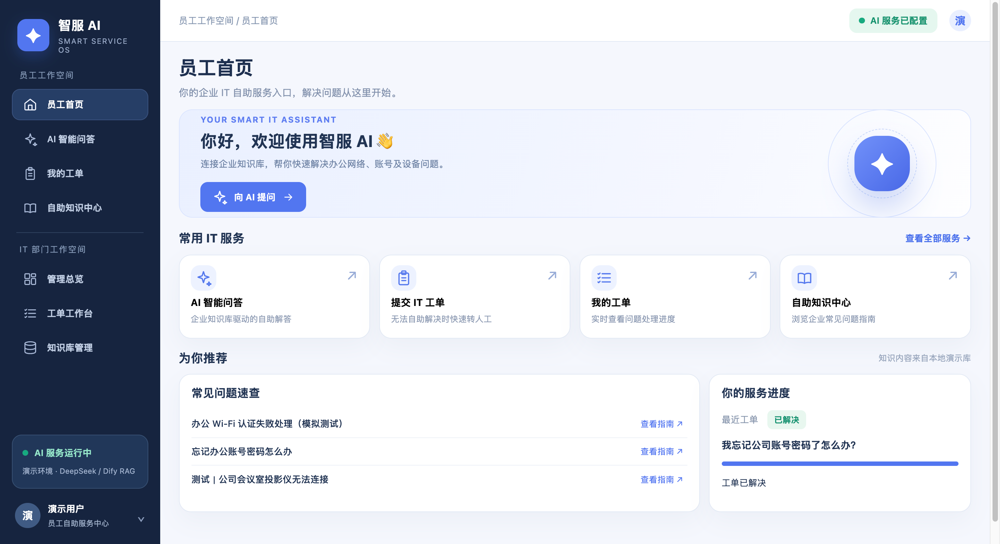
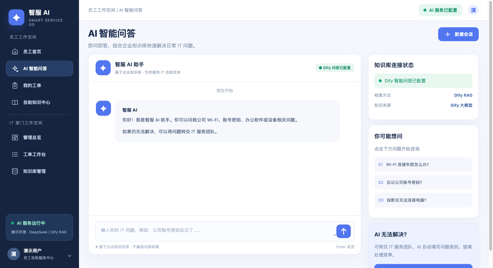
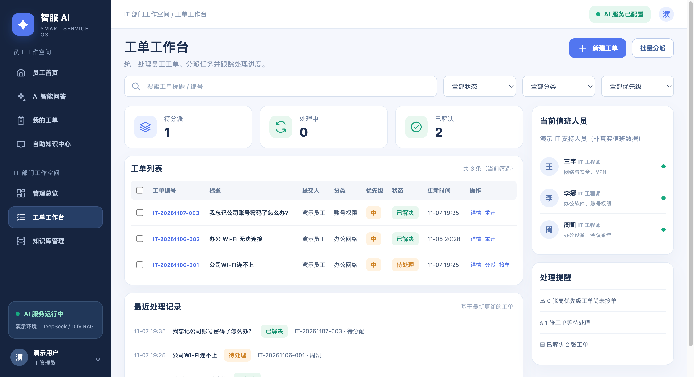
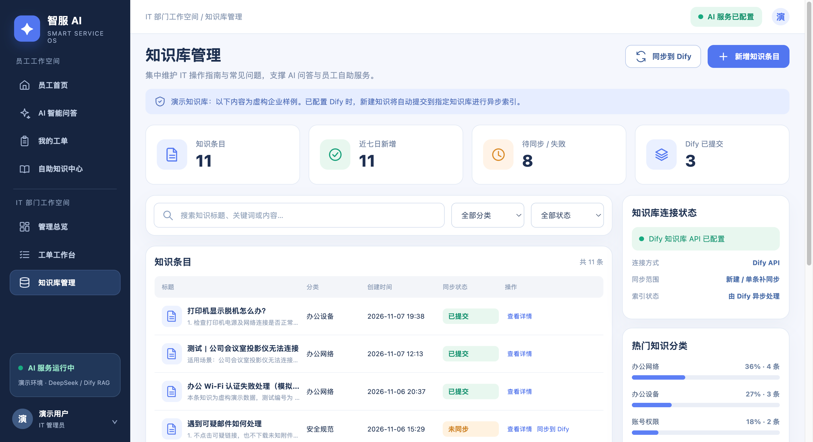

<div align="center">

# 智服 AI · 企业智能 IT 服务与知识管理平台

**Zhifu AI — Enterprise IT Service & Knowledge Management**

面向企业员工与 IT 支持人员的智能服务 MVP，围绕 **AI 问答 → 转人工工单 → IT 处理 → 知识沉淀** 构建服务闭环。

`Python` · `SQLite` · `HTML / CSS / JavaScript` · `Dify` · `DeepSeek` · `RAG`

</div>

## 项目简介

智服 AI 以企业 IT 服务为场景，提供员工自助咨询、智能问答、工单提交与追踪，以及 IT 工单管理和知识库维护功能。项目包含 **员工端与 IT 端共 9 个页面**，支持本地运行，也可接入 Dify 工作流实现大模型问答与知识检索增强。

## 核心功能

- **智能问答**：通过 Dify + 大模型 + RAG 回答常见 IT 问题，并识别问题类别。
- **工单闭环**：AI 问答可转人工并预填工单，员工查看进度，IT 人员更新处理状态。
- **知识管理**：支持知识查询、新增与管理，并可将新知识同步至 Dify 知识库。
- **双角色工作台**：提供员工自助服务界面及 IT 工单管理、统计总览界面。

## 产品界面

| 员工首页 | AI 智能问答 |
| :---: | :---: |
|  |  |

| IT 工单工作台 | 知识库管理 |
| :---: | :---: |
|  |  |

其余页面截图见 [`assets/screenshots/`](assets/screenshots/)。截图使用虚构演示数据。

## 技术方案

| 模块 | 技术 |
| --- | --- |
| 前端 | HTML、CSS、JavaScript |
| 后端与存储 | Python HTTP 服务、SQLite |
| AI 问答 | Dify Chatflow、DeepSeek、RAG（需单独配置） |
| 效果评测 | Python 批量测试脚本、30 条测试用例 |

**两种运行模式：** 未配置 Dify 时使用本地知识检索；完成 Dify 工作流和知识库配置后，可通过 API 使用大模型问答。

## 本地运行

需要 Python 3.9+，在项目根目录执行：

```bash
python3 app.py
```

浏览器访问：**http://127.0.0.1:8765**

如需连接 Dify，请自行创建 Chatflow 并配置模型与知识库，再通过环境变量设置 `DIFY_API_KEY` 等参数；配置项参见 [`.env.example`](.env.example)。仓库不包含真实 API Key 或云端 Dify 工作流。

## AI 效果评测

| 指标 | 第一轮结果 |
| --- | ---: |
| 测试用例 | 30 题（含 3 组双轮对话） |
| 问答测试用例执行成功率 | **100%（30/30）** |
| 问题分类与预期一致率 | **93.3%（28/30）** |

评测覆盖常见 IT 咨询、改写问题、知识缺口、安全边界和多轮对话。以上为**固定小样本测试集**结果，不代表生产环境效果或 AI 回答事实准确率；RAG Top-3 召回率尚未系统评测。

测试脚本位于 [`zhifu_ai_batch_eval/`](zhifu_ai_batch_eval/)，评测方法见 [效果评测说明](docs/EVALUATION.md)。

## 项目说明

本项目为虚构企业场景下的 **V4.0 演示 MVP**，未在真实企业部署；尚未实现真实用户登录、角色权限隔离、完整审批流与生产级运维能力。更多信息见 [产品范围](docs/PROJECT_SCOPE.md) 和 [技术架构](docs/ARCHITECTURE.md)。
