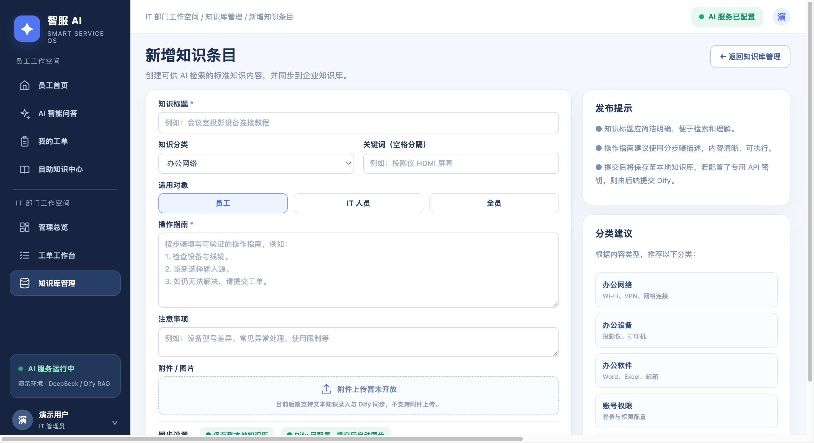
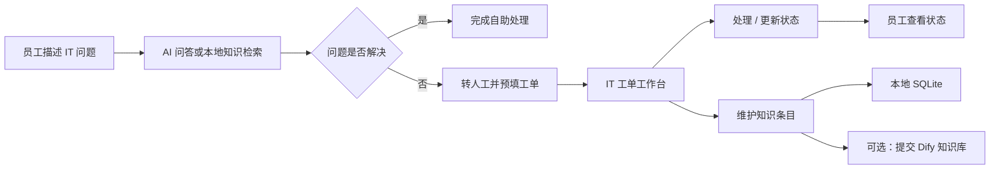
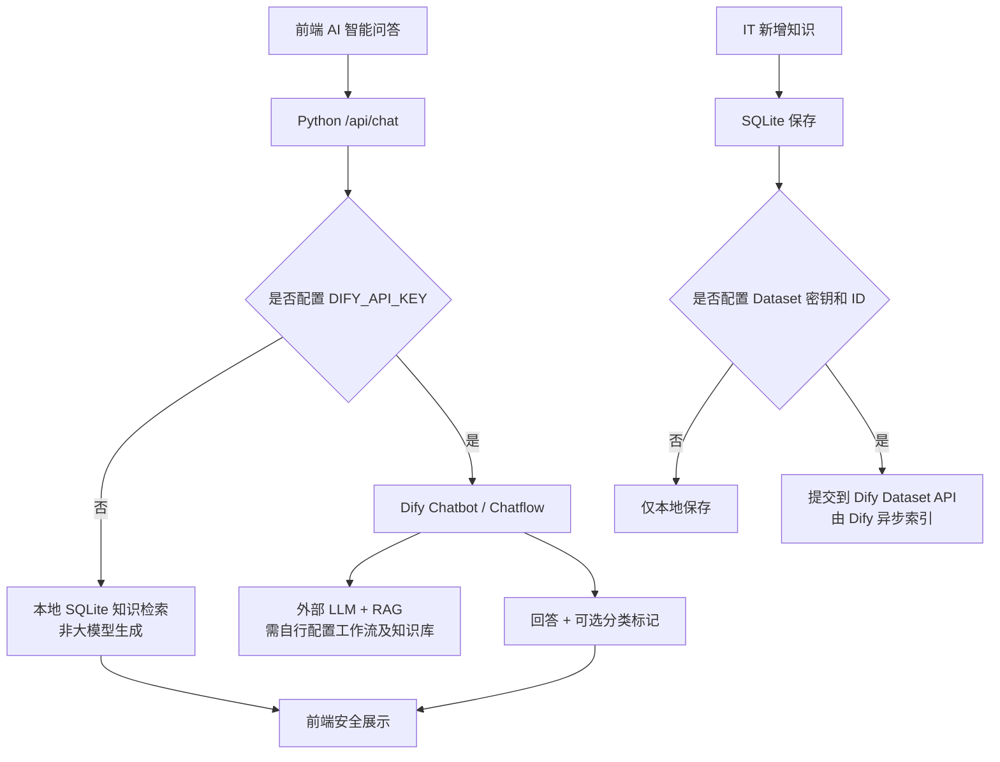

<div align="center">

# 智服 AI · 企业智能 IT 服务与知识管理平台

**Zhifu AI — Enterprise IT Service & Knowledge Management MVP**

本地可运行的企业 IT 服务产品作品集项目：**员工自助问答 → 创建工单 → IT 处理 → 知识沉淀**。

`Python 3.9+` · `SQLite` · `HTML / CSS / JavaScript` · `Dify Chatflow` · `DeepSeek（可选）` · `RAG（需配置）`

</div>

> **项目性质**：面向 AI 产品经理求职展示的个人 MVP / 虚构企业演示，不是已在真实企业部署的 ITSM 平台。所有 Wi-Fi 名称、员工身份与业务规则均为虚构示例。无需 Dify 密钥即可运行网页和本地检索；大模型问答功能依赖独立配置的 Dify 应用、模型与知识库。

## ✨ 项目概览

| 维度    | 内容                                                           |
| ----- | ------------------------------------------------------------ |
| 产品定位  | 面向员工与 IT 支持人员的智能服务与知识管理平台                                    |
| 核心用户  | 员工（自助咨询、提交与跟踪工单）；IT 人员（处理工单、管理知识）                            |
| 产品闭环  | AI 问答 / 本地知识检索 → 无法解决时转工单 → IT 流转 → 知识维护与同步                  |
| 页面    | 9 个：员工首页、AI 问答、我的工单、提交工单、自助知识中心、管理总览、工单工作台、知识管理、新增知识         |
| 技术架构  | 原生 Web 前端 + Python 标准库 HTTP 服务 + SQLite；Dify API 为可选外部 AI 能力 |
| AI 评测 | 30 个用例、28 个分类一致（93.3%）、30/30 用例执行成功；均为本次小样本测试集结果             |

## 🖥️ 产品界面

> 以下截图直接由本仓库最终 V4.0 前端运行所得，使用**临时生成的虚构演示数据**，采用虚构演示数据。截图展示的是本地模式界面，不等于 Dify 云端模型效果截图。

| 员工首页 | AI 智能问答 |
| ---- | ------- |
| 员工首页 | AI 问答   |

| 工单工作台 | IT 管理总览 |
| ----- | ------- |
| 工单工作台 | 管理总览    |

<details>

<summary>展开查看其他 5 张产品页面</summary>

| 我的工单 | 提交工单 |
| ---- | ---- |
| 我的工单 | 提交工单 |

| 自助知识中心 | 知识库管理 |
| ------ | ----- |
| 自助知识中心 | 知识库管理 |



</details>

## 🔄 关键业务流程



- **员工侧**：查看知识指南；在 AI 问答中提问，必要时转为 IT 工单；查询工单进度。
- **IT 侧**：通过工作台筛选、分派和更新工单；新增知识并可选提交到 Dify 文本知识库。
- **辅助决策**：管理总览统计基于本地演示数据库；未实现的指标不会伪造数值。

## 🧠 AI 方案与工作模式



**请注意**：仓库不包含 Dify Chatflow 配置文件、模型凭据及云端知识库，相关 AI 能力需独立配置。前端对 Dify 回复末尾的分类标记进行解析；如果 AI 没有提供有效分类，会回退到关键词推荐。历史知识中的“软件应用”“安全规范”等旧名称与当前五分类并存，详见 [功能范围说明](docs/PROJECT_SCOPE.md)。

## 🚀 本地运行（Mac / Windows / Linux）

**要求**：Python 3.9 或更新版本；无需 `pip install`、无需 npm / Node 才能启动网页。

```bash
# 进入本仓库根目录
cd zhifu-ai-enterprise-service-platform

# 启动演示服务（未配置 Dify 时使用本地知识检索）
python3 app.py
```

Windows 可将 `python3` 换为 `py`，然后浏览器打开：

**<http://127.0.0.1:8765>**

首次运行会在本地**自动创建 `zhifu_demo.sqlite3`**，并写入 8 条虚构演示知识；该数据库被 `.gitignore` 排除，不会提交仓库。默认监听本机回环地址 `127.0.0.1`，不是公网部署。

### 可选：启用 Dify + DeepSeek / RAG

需要先在 Dify 创建可通过 `/v1/chat-messages` 调用的 **Chatbot / Chatflow** 应用并自行搭建知识检索、模型与回答节点；仅设置 API Key 不会自动创建云端工作流。

Mac / Linux 示例：

```bash
export DIFY_API_BASE='https://api.dify.ai/v1'  # 可根据实际部署环境调整
export DIFY_API_KEY='YOUR_DIFY_API_KEY'
# 若需要将新增知识同步到 Dify，需额外设置：
export DIFY_KB_API_KEY='YOUR_DATASET_API_KEY'
export DIFY_DATASET_ID='YOUR_DATASET_ID'
python3 app.py
```

API 密钥通过系统环境变量配置，不在代码仓库中存储。`.env.example` 仅列出环境变量名称，项目不会自动解析 `.env`。如果设置了环境变量但 Dify 不可用，问答可能直接返回 API 错误，而不是自动回退为本地模式。

## 🧪 测试与 AI 效果评估

```bash
# 后端与分类解析的单元测试
python3 -m unittest discover -s tests -v

# 前端 Markdown/HTML 安全渲染单元测试（需要 Node.js）
node tests/test_markdown.js

# 批量评测：先运行项目服务并正确配置 Dify
python3 zhifu_ai_batch_eval/run_eval.py --dry-run
python3 zhifu_ai_batch_eval/run_eval.py           # 首批 5 题
python3 zhifu_ai_batch_eval/run_eval.py --all     # 全部 30 题
```

批量评测器仅访问 `/api/health` 和 `/api/chat`，不会写入工单或知识。真实运行会消耗 Dify/模型供应商 API 额度。结果会写入 `zhifu_ai_batch_eval/eval_output/`，**该目录不纳入公开仓库**。

### 第一轮实际评测摘要

| 指标            |             结果 | 解释                 |
| ------------- | -------------: | ------------------ |
| 测试用例数         |             30 | 包含 3 组双轮对话场景       |
| 问答测试成功用例      |  30 / 30（100%） | 接口成功返回，不等于回答全都正确   |
| 分类与预期一致       | 28 / 30（93.3%） | 在人工定义标签上的一致比例      |
| 平均用例响应时间      |        12.29 秒 | 多轮用例按整题合计耗时计算      |
| RAG Top-3 命中率 |             暂无 | 尚未完整采集 Dify 检索节点证据 |
| 回答事实准确率       |             暂无 | 尚未完成逐题知识事实核验       |

两个分类争议（T17 / T25）与钓鱼邮件、账号安全边界有关。请参见 [评测方法与结论](docs/EVALUATION.md)。

## 📂 仓库结构

```text
zhifu-ai-enterprise-service-platform/
├── app.py                    # Python 标准库后端 / SQLite / Dify API
├── static/                   # 9 个页面的 HTML / CSS / JavaScript
├── tests/                    # Python 单测、前端 Markdown 单测
├── zhifu_ai_batch_eval/      # 30 题测试集与无第三方依赖的批量评测脚本
├── assets/screenshots/       # 基于 V4.0 真实前端的虚构数据展示截图
├── docs/                     # 产品范围、架构、评测、安全说明
├── scripts/                  # GitHub 发布前安全检查
├── .env.example              # 环境变量名称示例（无密钥）
├── .gitignore                # 排除运行数据库、评测输出、环境变量
└── README.md
```

## ⚠️ MVP 边界与已知限制

- **无真实用户登录及 RBAC 权限隔离**：员工、IT 端只是演示工作空间，切勿输入真实企业工单或隐私信息。
- **不是生产级 ITSM**：没有多租户、审计日志、正式审批流、附件上传、真实 SLA 或满意度采集。
- **Dify 工作流、账号与云端 Dataset 不在仓库中**：需自行配置；知识同步提交成功不等于完成检索索引。
- **历史分类名称有兼容差异**：内置演示知识中保留“软件应用”“安全规范”，目前 UI 对部分名称做兼容展示；非完整分类治理。
- **评测是离线小样本评估**：没有生产流量、人工大规模标注或完整的 RAG Top-3 检索日志。

更多细节：[功能与边界](docs/PROJECT_SCOPE.md) · [技术架构](docs/ARCHITECTURE.md) · [效果测评]（docs/EVALUATION.md）

## 📌 项目状态

**V4.0 作品集展示版本，功能范围已冻结。** 本仓库用于展示产品分析、AI 服务设计、RAG 接入思路、业务闭环与实验评测，不宣称已在真实企业上线。

