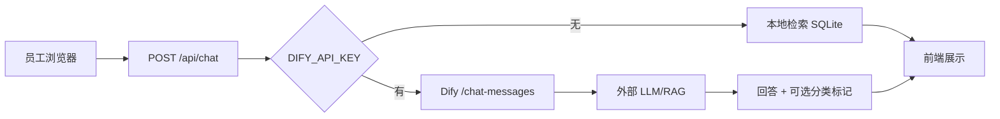
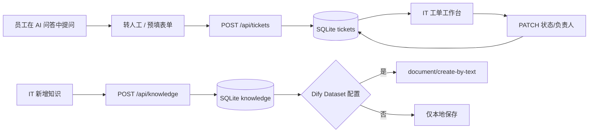

# 技术架构与业务数据流

## 构成

- **前端**：`static/index.html`、`style.css`、`app.js`；原生 HTML/CSS/JS；导航和详情弹窗在客户端实现。
- **本地服务**：`app.py`；Python 标准库 `ThreadingHTTPServer`，监听 `127.0.0.1:8765`（可通过 `ZHIFU_PORT` 改变端口）。
- **数据存储**：SQLite；知识表 `knowledge`、同步记录 `knowledge_sync`、工单表 `tickets`。缺省数据库 `zhifu_demo.sqlite3` 在启动时创建。
- **本地问答**：bigram / 关键词匹配，从 SQLite 检索相关条目并返回文档正文，**非生成式大模型**。
- **大模型模式**：配置 `DIFY_API_KEY` 后，后端使用 `/chat-messages` 调用外部配置的 Dify Chatbot/Chatflow。模型（如 DeepSeek）与 RAG 均在 Dify 端配置，不在本仓库硬编码。
- **知识同步**：配置 `DIFY_KB_API_KEY` 与 `DIFY_DATASET_ID` 后，调用 Dify Dataset `document/create-by-text`；提交成功不等于已可检索，索引由 Dify 异步完成。

## 问答流程

Dify 可将预期类别通过 `[[ZHIFU_CATEGORY:办公网络]]` 等后缀传递。后端仅接受五种合法类别并清理末尾标记，同时剔除外部模型可能泄漏的 `<think>` 文本。没有有效分类时，前端可根据关键词给出**推荐**类别，不标为模型识别。

## 工单与知识流

## 安全边界

目前不是多租户或生产级 Web 服务，没有认证授权；只在本机监听。评测脚本不需要知道 Dify API Key，只向本机后端请求。
